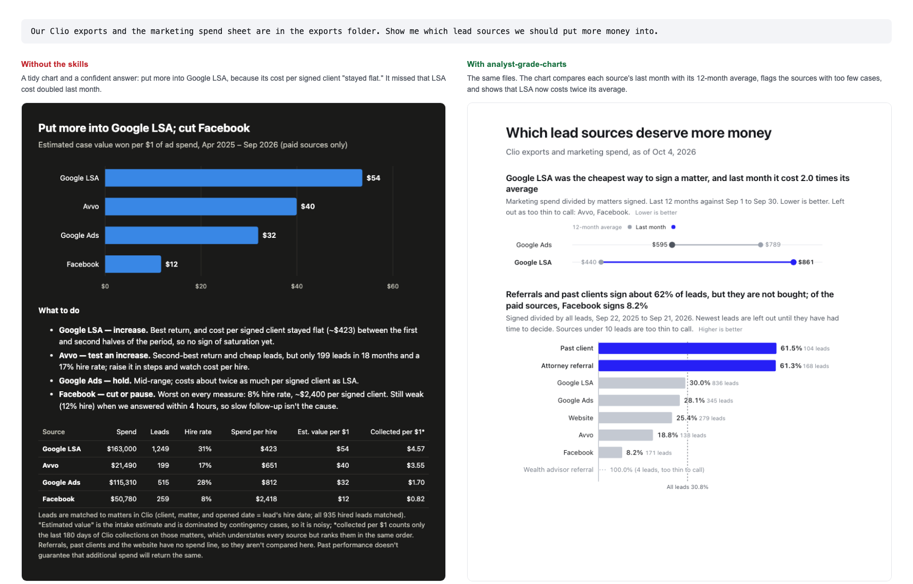

# Law firm analytics for Claude

> Make Claude chart like an analytics engineer. Two free Claude skills: analyst-grade charts, and a Monday 8am briefing written from your numbers. Open source and yours to keep.



## What you get

**Analyst-grade charts.** Give Claude a report from your practice management system and ask a question. It picks the chart from the question, not from the shape of the data. The axes are honest, the labels sit on the data instead of in a legend, and one accent color marks the thing to look at first. Red, amber and green mean the same thing every time: a cost that goes up is never green. It shows how many cases stand behind a number, and says so when there are too few. It knows what signed rate, cost per signed matter, speed to lead, realization, collections and receivables mean, which direction is good, and what window each should be read over.

**The Monday 8am briefing.** From the same numbers, Claude writes the one-page memo an owner reads before the partner meeting: what changed, why it probably changed, and what to look at. It leads with the change that matters most and does not recite every metric. Every number in it is computed by a script, not guessed, and checked against your files before you see it. When there is not enough data to conclude anything, it says so.

They work with exports from any system. Clio is the one we know best, so its reports are recognized automatically. If you use something else, the skills read the file by meaning and ask you to confirm what each column is.

## Install in five minutes

### On claude.ai

1. Go to Settings, then Capabilities, and turn on **Code execution and file creation**. The skills run small scripts, and this is what lets them. On Team and Enterprise plans an owner turns this on for the organization.
2. Download the two zip files from the [latest release](https://github.com/swyftinc/law-firm-analytics/releases/latest): `analyst-grade-charts.zip` and `monday-8am-briefing.zip`.
3. Go to Customize, then Skills. Press **+**, then **+ Create skill**, and choose **Upload a skill**. Pick a zip, then do it again for the second.

Anthropic's help center lists Skills as available on every claude.ai plan. For the current details, see [Using Skills in Claude](https://support.claude.com/en/articles/12512180-using-skills-in-claude) for the current details.

### In Claude Code

```
/plugin marketplace add swyftinc/law-firm-analytics
/plugin install law-firm-analytics@law-firm-analytics
```

### Through the API

Upload each folder in `skills/` with the Skills API and run it with the code execution tool. The [Skills guide](https://platform.claude.com/docs/en/build-with-claude/skills-guide) shows how.

## Try it without your own data

Each skill carries a made-up firm called Super Duper Law, shaped like real Clio exports. Paste any of these into Claude:

1. `Use analyst-grade-charts on the sample firm. Which lead sources should it put more money into?`
2. `Use monday-8am-briefing on the sample firm and write this Monday's briefing.`
3. `I use Clio. Use analyst-grade-charts. Which reports should I export to see where my ad money is going, and how?`

## Use your own numbers

Tell Claude which system you use, or just attach a report. Claude asks at most three short questions: who this is for, where your records live, and what decision it is for. Then it tells you which one or two reports to export. It doesn't ask for everything.

CSV and Excel files are supported. There is a short guide for each of 17 systems, and a generic one for anything else, in [`skills/analyst-grade-charts/references/systems/`](skills/analyst-grade-charts/references/systems/README.md). Each says what we could and could not verify, and when we last checked.

Some systems have a connector, and technical users can have Claude Code build a read-only connection to their own account. Both are optional and explained in the guides, with a checklist for judging any community-built server. The simple path, and the one we'd suggest, is the export.

## Your firm's data

These skills ask for the least they can. Counts and totals are enough for almost everything, so the skills don't need client names or matter details, and they never ask for a password or key in the chat. Files stay in your own Claude account or on your own computer. Lawyers have duties about client information and the tools they use, so check your state bar's guidance on generative AI and your firm's policy before you upload anything. [ABA Formal Opinion 512](https://www.americanbar.org/content/dam/aba/administrative/professional_responsibility/ethics-opinions/aba-formal-opinion-512.pdf) on generative AI tools is a starting point. This is not legal advice.

## How it works

Python scripts handle everything that involves a number. They read your file and work out what it is. They compute each metric over the window it should be read over, compare it with the period before, and test whether the change is bigger than normal variation. They rank what changed by the dollars it moves, draw the charts, and check that every number in a briefing came from your data. Claude does the rest: it chooses the chart, explains why something probably changed, and writes it in plain English.

Everything is defined in files you can read. `references/metrics.md` says what each metric means. `references/chart-doctrine.md` says how the charts are drawn and why. `references/foundations.md` credits the books behind the rules, and [the reading list](docs/reading-list.md) is where to start if you want the originals.

## Does it work

There's a test suite. Twenty prompts run, most of them against the sample firm, with an answer key computed separately from the skills. The tests check that the chart type fits the question, that the math matches the key, that no status color is inverted, that thin data is called thin, that a briefing leads with the right finding, and that no number appears that isn't in the data. Each prompt also runs without the skills, so you can see what they add.

## For developers

Run the checks yourself. The engine has unit tests, and the evals use Claude Code's plugin eval command:

```
python3 -m unittest discover -s tests
claude plugin eval . --scaffold --trust-plugin --allow-tools Bash Write Edit
```

The eval command needs Claude Code 2.1.269 or later. It makes many model calls, so add `--max-cost-usd` to cap the spend.

The skills are built from `src/` by `python3 tools/build.py`, which also validates them and writes the upload zips. The sample data comes from `tools/generate_sample_data.py`.

## Contributing and maintenance

Issues and pull requests are welcome. Systems change their menus, so each guide carries the date it was checked. If something is out of date, say so in an issue.

## License

[MIT](LICENSE). Use it, change it, share it, keep it.

This project is not affiliated with or endorsed by Anthropic, Clio or any other company named here.

---

Built by Swyft. If you want to talk through your numbers with an analyst, you can [book 30 minutes](https://cal.com/swyft/cliocon).
